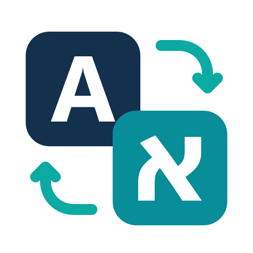
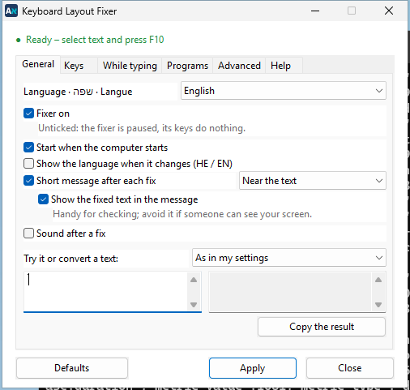
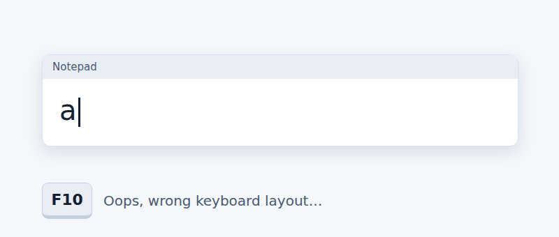
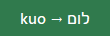
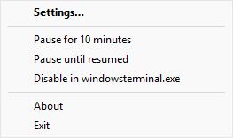
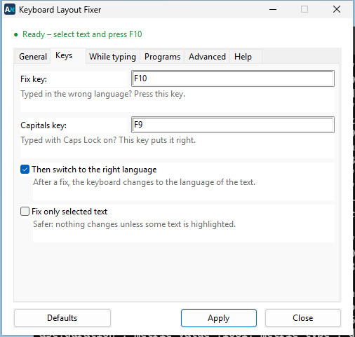
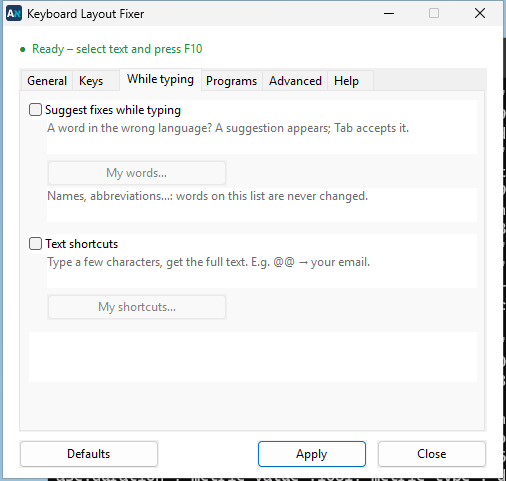
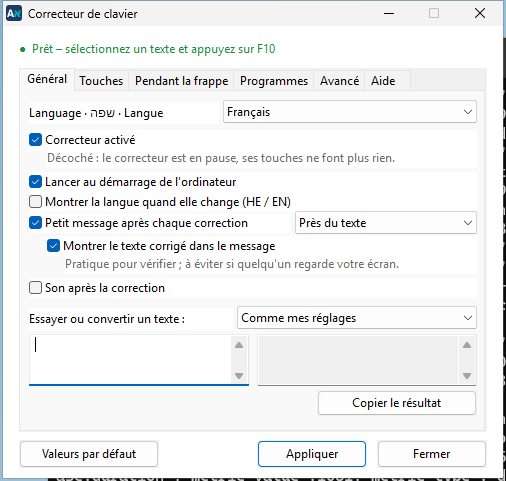
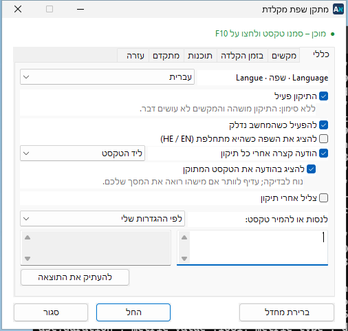

<h1 align="center">
 
Keyboard Layout Fixer
</h1>

<a href="#français">Français</a> · <a href="#עברית">עברית</a> · <a href="#technical-details">Technical details</a>

<b>Typed in Hebrew with the keyboard set to English (or the reverse)? Press F10 and the text is fixed.</b> 
A small, free program for Windows 10 and 11.

<a href="https://github.com/breslev558/hebrew-keyboard-layout-fixer/releases/latest/download/KeyboardLayoutFixer-Setup.exe">
<picture>
<source media="(prefers-color-scheme: dark)" srcset="docs/download-dark.svg">
<source media="(prefers-color-scheme: light)" srcset="docs/download-light.svg">

</picture>
</a>

KeyboardLayoutFixer-Setup.exe, about 0.5 MB, for Windows 10 and 11 
Antivirus blocks the installer? Take the <a href="https://github.com/breslev558/hebrew-keyboard-layout-fixer/releases/latest/download/KeyboardLayoutFixer.exe"><b>program alone</b></a> (no installation needed) 
<a href="https://github.com/breslev558/hebrew-keyboard-layout-fixer/releases/latest/download/KeyboardLayoutFixer-Setup-arm64.exe">ARM64 installer</a> (Snapdragon, Copilot+ PCs) ·
<a href="https://github.com/breslev558/hebrew-keyboard-layout-fixer/releases/latest/download/KeyboardLayoutFixer.zip">zip</a> ·
<a href="https://github.com/breslev558/hebrew-keyboard-layout-fixer/releases/latest">all release files</a> ·
<a href="https://breslev558.github.io/hebrew-keyboard-layout-fixer/">website</a>

## How to use it

1. **Install it.** [Download the installer](https://github.com/breslev558/hebrew-keyboard-layout-fixer/releases/latest/download/KeyboardLayoutFixer-Setup.exe) and double-click it. You do not need administrator rights. If Windows says **"Windows protected your PC"**, click **More info**, then **Run anyway**. (The program is not yet signed with a certificate Windows knows. A free signature has been requested.)
2. **Type as usual.** If you see `akuo` when you wanted `שלום`, the keyboard was on the wrong language. No problem.
3. **Press F10.** Select the text first, or just leave the cursor at the end of it. The text becomes `שלום` and the keyboard switches to Hebrew, so you can keep typing.

Good to know:

- Pressed F10 by mistake? Press **F10 again** within 5 seconds: the original text comes back.
- Typed with Caps Lock on (`hELLO wORLD`)? Press **F9**. You get `Hello World`.
- The program sits near the clock (the small icon). If you do not see it, click the small ^ arrow. **Click it** to open the settings. **Right-click it** to pause the program or to quit.
- It works with Hebrew and English, and with Hebrew and French (AZERTY).

 &nbsp; 

## Settings

Click the icon near the clock. The settings window has six tabs. Everything is already set up well, so you can ignore them.

| Tab | What it is for |
| --- | --- |
| **General** | Language of the program, turn the fixer on or off, start with Windows, the small message after each fix, and a box to try it. |
| **Keys** | Choose the keys: F10 to fix, F9 for Caps Lock. Choose if the keyboard switches language after a fix, and if only selected text is fixed. |
| **While typing** | Two options, off at first. *Suggest fixes while typing*: a bubble offers the fix and **Tab** accepts it. *Text shortcuts*: type `@@` and get your email address. |
| **Programs** | Programs where nothing is fixed (games, for example), programs where only selected text is fixed, and programs that always use one language. |
| **Advanced** | Rarely needed: fix only the wrong words, double-tap Shift, Ctrl keys to change language, limits, export and import of your settings. |
| **Help** | What happened last time, technical details to copy, report a problem, check for updates, version and links. |

 &nbsp; 

The settings are in English, Hebrew or French. The program follows your Windows language, or you can choose it in the **General** tab.

## FAQ

**Windows or my antivirus warns me. Is it dangerous?** 
No. The program is new and not yet signed with a certificate Windows knows, so Windows is careful. You can check the file: see [Technical details](docs/TECHNICAL.md#check-the-download). If your antivirus blocks the installer, take the [program alone](https://github.com/breslev558/hebrew-keyboard-layout-fixer/releases/latest/download/KeyboardLayoutFixer.exe).

**F10 changed the wrong thing.**
Press F10 again within 5 seconds, or press Ctrl+Z in the app where you were typing. Then select exactly the text to fix and press F10. To always fix only selected text, tick **Fix only selected text** in the **Keys** tab.

**F10 does nothing in one app.** 
Some apps do not accept the fix: apps started "as administrator", and a few others. In a remote-control window (Remote Desktop, AnyDesk, TeamViewer...), install the program on the other PC too. Check that the program is not paused (right-click the icon).

**Can I use another key than F10?** 
Yes. Open the settings, tab **Keys**, and choose your key. On a laptop where F10 needs the Fn key, you can use a double tap on Shift (tab **Advanced**).

**Does the program watch what I type?** 
It never sends anything. By default it only counts key presses, never which keys. The options in the **While typing** tab keep the last few words in memory only, and forget them quickly. They are off at first.

**I play online games with anti-cheat.**
Some anti-cheat systems dislike programs that listen to the keyboard. Quit the fixer before playing (right-click the icon, **Exit**), and start it again after.

**How do I remove it?** 
Windows Settings, **Apps**, **Installed apps** (Windows 10: **Apps & features**), then **Keyboard Layout Fixer**, then **Uninstall**. It asks if you also want to delete your settings.

## Safety and privacy

- What you type is **never sent anywhere**. No account, no ads, no tracking.
- The Internet is used only to look once a day for a new version (you can turn this off) and, if you click, to send an anonymous problem report. Nothing is installed without your click, and every update is checked first.
- Every change to the program is tested automatically, and the code is open for everyone to read.

More details: [PRIVACY.md](PRIVACY.md) (what is kept and what is sent) and [THREAT_MODEL.md](THREAT_MODEL.md) (what could go wrong, and how each risk is handled). To report a security problem privately: [SECURITY.md](SECURITY.md).

## Where it comes from

Keyboard Layout Fixer is an independent project. It grew from an idea of the [Keyboard Layout Fixer](https://github.com/RavidSaadia/Keyboard_Layout_Fixer) project by Ravid Saadia, then was entirely rewritten in Rust. The two projects are separate: they do not share their code or their documentation. The original documentation is kept in [docs/archive](docs/archive).

## Licence

Free software, under the MIT licence. Copyright (c) 2026 ravid saadia, and (c) 2026 breslev558 (Rust rewrite and modifications). See [LICENSE](LICENSE).

## Technical details

Updates and how they are signed, checking a download, installing without the installer, settings enforced by an administrator, building from source, word lists, problem reports, limits and project files: see **[docs/TECHNICAL.md](docs/TECHNICAL.md)**.

Project files: [CHANGELOG.md](CHANGELOG.md) · [PRIVACY.md](PRIVACY.md) · [THREAT_MODEL.md](THREAT_MODEL.md) · [SECURITY.md](SECURITY.md) · [PERFORMANCE.md](PERFORMANCE.md) · [CONTRIBUTING.md](CONTRIBUTING.md) · [CODE_SIGNING_POLICY.md](CODE_SIGNING_POLICY.md) · [audits/](audits)

---

## Français

**Vous avez tapé `akuo` au lieu de `שלום` ? Appuyez sur F10 et le texte est corrigé.** Un petit programme gratuit pour Windows 10 et 11. Hébreu et anglais, ou hébreu et français (AZERTY).

**[Télécharger KeyboardLayoutFixer-Setup.exe](https://github.com/breslev558/hebrew-keyboard-layout-fixer/releases/latest/download/KeyboardLayoutFixer-Setup.exe)** (PC Windows sur ARM : [version ARM64](https://github.com/breslev558/hebrew-keyboard-layout-fixer/releases/latest/download/KeyboardLayoutFixer-Setup-arm64.exe)). Si votre antivirus bloque l'installateur, prenez le [programme seul](https://github.com/breslev558/hebrew-keyboard-layout-fixer/releases/latest/download/KeyboardLayoutFixer.exe).

### Comment l'utiliser

1. **Installez-le** : double-cliquez sur le fichier téléchargé. Aucun droit d'administrateur n'est nécessaire. Si Windows affiche « Windows a protégé votre ordinateur », cliquez sur **Informations complémentaires**, puis **Exécuter quand même**.
2. **Tapez comme d'habitude.** Si vous voyez `akuo` au lieu de `שלום`, le clavier était dans la mauvaise langue.
3. **Appuyez sur F10.** Sélectionnez le texte d'abord, ou laissez le curseur à la fin. Le texte est corrigé et le clavier change de langue.

F10 par erreur ? Un deuxième **F10** dans les 5 secondes remet le texte d'origine. **F9** corrige un texte tapé avec Verr. Maj activé.

### Les 6 onglets des réglages

Cliquez sur l'icône près de l'horloge.

- **Général** : langue, activer ou mettre en pause, démarrage avec Windows, petit message après chaque correction, zone d'essai.
- **Touches** : choisir les touches (F10, F9), changer de langue après la correction, corriger seulement le texte sélectionné.
- **Pendant la frappe** : *Proposer la correction pendant la frappe* (Tab l'accepte) et *Raccourcis de texte* (par exemple `@@` donne votre adresse e-mail). Désactivés au départ.
- **Programmes** : programmes où rien n'est corrigé (jeux...), où seul le texte sélectionné l'est, ou qui utilisent toujours une seule langue.
- **Avancé** : rarement utile (mots faux seulement, double appui sur Maj, export et import).
- **Aide** : ce qui s'est passé, signaler un problème, rechercher une mise à jour, version.

### Sécurité et vie privée

Rien de ce que vous tapez n'est envoyé. Pas de compte, pas de publicité. Internet sert seulement à chercher une nouvelle version une fois par jour (vous pouvez l'arrêter) et, si vous cliquez, à envoyer un rapport de problème anonyme. Rien ne s'installe sans votre clic. Détails : [PRIVACY.md](PRIVACY.md) et [THREAT_MODEL.md](THREAT_MODEL.md).

### Origine

Projet indépendant, né d'une idée du projet [Keyboard Layout Fixer](https://github.com/RavidSaadia/Keyboard_Layout_Fixer) de Ravid Saadia, puis entièrement réécrit en Rust. Les deux projets sont distincts. Licence MIT : voir [LICENSE](LICENSE).

---

## עברית

**הקלדתם `akuo` במקום `שלום`? לחצו F10 והטקסט מתוקן.** תוכנה קטנה וחינמית ל-Windows 10 ו-Windows 11. עברית ואנגלית, או עברית וצרפתית (AZERTY).

**[הורדת KeyboardLayoutFixer-Setup.exe](https://github.com/breslev558/hebrew-keyboard-layout-fixer/releases/latest/download/KeyboardLayoutFixer-Setup.exe)** (מחשב Windows על ARM: [גרסת ARM64](https://github.com/breslev558/hebrew-keyboard-layout-fixer/releases/latest/download/KeyboardLayoutFixer-Setup-arm64.exe)). אם האנטי-וירוס חוסם את קובץ ההתקנה, הורידו את [התוכנה לבדה](https://github.com/breslev558/hebrew-keyboard-layout-fixer/releases/latest/download/KeyboardLayoutFixer.exe).

### איך משתמשים

1. **מתקינים**: לוחצים פעמיים על הקובץ שהורדתם. לא צריך הרשאות מנהל. אם מופיעה ההודעה "Windows הגן על המחשב שלך", לוחצים **מידע נוסף** ואז **הפעל בכל זאת**.
2. **מקלידים כרגיל.** אם רואים `akuo` במקום `שלום`, המקלדת הייתה בשפה הלא נכונה.
3. **לוחצים F10.** מסמנים את הטקסט קודם, או משאירים את הסמן בסופו. הטקסט מתוקן והמקלדת עוברת לשפה הנכונה.

לחצתם בטעות? לחיצה שנייה על **F10** תוך 5 שניות מחזירה את הטקסט המקורי. **F9** מתקן טקסט שהוקלד כש-Caps Lock היה מופעל.

### שש הלשוניות בהגדרות

לוחצים על הסמל ליד השעון.

- **כללי**: שפת התוכנה, הפעלה או השהיה, הפעלה עם Windows, הודעה קטנה אחרי כל תיקון, ותיבה לניסיון.
- **מקשים**: בחירת המקשים (F10, F9), מעבר לשפה הנכונה אחרי התיקון, ותיקון של טקסט מסומן בלבד.
- **בזמן הקלדה**: *הצע תיקון בזמן ההקלדה* (Tab מאשר) ו*קיצורי טקסט* (למשל `@@` נותן את כתובת המייל שלכם). כבויים בהתחלה.
- **תוכנות**: תוכנות שבהן שום דבר לא מתוקן (משחקים...), תוכנות שבהן מתוקן רק טקסט מסומן, ותוכנות בשפה אחת קבועה.
- **מתקדם**: נדרש לעיתים רחוקות (רק מילים שגויות, לחיצה כפולה על Shift, ייצוא וייבוא).
- **עזרה**: מה קרה בפעם האחרונה, דיווח על תקלה, חיפוש עדכון וגרסה.

### אבטחה ופרטיות

שום דבר ממה שאתם מקלידים לא נשלח. אין חשבון ואין פרסומות. האינטרנט משמש רק לבדיקה יומית אם יש גרסה חדשה (אפשר לכבות), ואם תלחצו, לשליחת דיווח אנונימי על תקלה. שום דבר לא מותקן בלי לחיצה שלכם. פרטים: [PRIVACY.md](PRIVACY.md) ו-[THREAT_MODEL.md](THREAT_MODEL.md).

### מקור

פרויקט עצמאי, שצמח מרעיון של הפרויקט [Keyboard Layout Fixer](https://github.com/RavidSaadia/Keyboard_Layout_Fixer) של Ravid Saadia, ואז נכתב מחדש כולו ב-Rust. שני הפרויקטים נפרדים. רישיון MIT: ראו [LICENSE](LICENSE).
