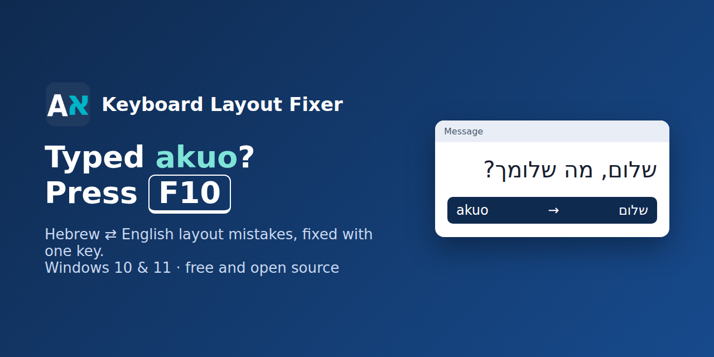
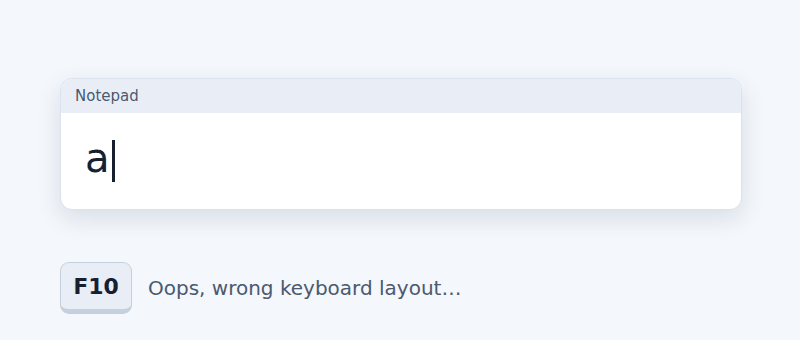

<p align="center"></p>

<p align="center"><b>Typed a word with the wrong keyboard layout? Press F10.</b><br>
A tiny Windows 10/11 app that fixes Hebrew ⇄ English layout mistakes (also French AZERTY) and text typed with Caps Lock on.</p>

<p align="center">
<a href="https://github.com/breslev558/hebrew-keyboard-layout-fixer/releases/latest/download/KeyboardLayoutFixer-Setup.exe"><b>⬇ Download for Windows 10 / 11</b></a><br>
<sub>one file, no administrator rights · <a href="https://github.com/breslev558/hebrew-keyboard-layout-fixer/releases/latest/download/KeyboardLayoutFixer-Setup-arm64.exe">Windows on ARM version</a> · <a href="https://github.com/breslev558/hebrew-keyboard-layout-fixer/releases/latest/download/KeyboardLayoutFixer.zip">zip version</a> · <a href="https://breslev558.github.io/hebrew-keyboard-layout-fixer/">presentation page</a></sub>
</p>

<p align="center">
<a href="https://github.com/breslev558/hebrew-keyboard-layout-fixer/releases/latest"></a>
<a href="https://github.com/breslev558/hebrew-keyboard-layout-fixer/actions/workflows/ci.yml"></a>

<a href="LICENSE"></a>
<a href="https://www.bestpractices.dev/projects/16504"></a>
<a href="https://scorecard.dev/viewer/?uri=github.com/breslev558/hebrew-keyboard-layout-fixer"></a>
</p>

<p align="center"></p>

You meant to write:

```
שלום
```

but the keyboard was still on English, so you got:

```
akuo
```

Select it (or just leave the cursor at the end of the line) and press **F10**: it becomes `שלום` and the keyboard switches to Hebrew. It works the other way too: `גםןמע` → `hello`.

<p align="center"><a href="#english">English</a> · <a href="#français">Français</a> · <a href="#עברית">עברית</a></p>

## English

### What it does
- **F10** – converts the selected text to the other keyboard layout (`akuo` → `שלום`, `גםןמע` → `hello`). With nothing selected, it converts from the cursor back to the start of the line.
- **F9** – fixes text typed with Caps Lock on (`hELLO wORLD` → `Hello World`) and switches Caps Lock off.
- A small bubble shows what was converted (`akuo → שלום`); it can be switched off in the tray menu.
- Your clipboard is saved beforehand and restored afterwards; password fields, administrator windows and consoles are left alone.
- A small tray app (icon near the clock): one executable of about 700 KB written in Rust, no runtime to install (no .NET), a few MB of memory. Native builds for x64 and ARM64 (Windows on ARM).

### Install (no administrator rights needed)
1. [Download **KeyboardLayoutFixer-Setup.exe**](https://github.com/breslev558/hebrew-keyboard-layout-fixer/releases/latest/download/KeyboardLayoutFixer-Setup.exe) and double-click it. On a Windows on ARM PC (Snapdragon, Copilot+), take [KeyboardLayoutFixer-Setup-arm64.exe](https://github.com/breslev558/hebrew-keyboard-layout-fixer/releases/latest/download/KeyboardLayoutFixer-Setup-arm64.exe) instead.
2. That's all: the program is installed for your account only (in `%LOCALAPPDATA%\Programs\KeyboardLayoutFixer`), starts with Windows, appears near the clock and shows a short welcome window. (Without the installer: download the [zip](https://github.com/breslev558/hebrew-keyboard-layout-fixer/releases/latest/download/KeyboardLayoutFixer.zip), extract it and double-click **Installer.cmd**.)
3. On first run, SmartScreen may show *“Windows protected your PC”* because the program is not yet signed by a public certificate (a free [SignPath](https://signpath.org) signature has been requested). To check the download, compare its SHA-256 with the one on the [release page](https://github.com/breslev558/hebrew-keyboard-layout-fixer/releases/latest) (`Get-FileHash KeyboardLayoutFixer-Setup.exe` in PowerShell), then click **More info › Run anyway**.

To update by hand, run the new installer over the existing installation: the running copy is closed cleanly and your settings are kept.

### Use and settings
- **Right-click the icon**: pause (10 minutes or until resumed), turn the program off for the current application, show or hide the corrected text in the bubble, settings, updates, problem reports, about, exit.
- **Settings window** (click the icon), in English, Hebrew or French: change the keys, conversion direction, careful mode (selection only), Caps Lock behaviour, confirmation bubble (top, bottom or near the cursor), per-program rules, diagnostic and export/import of your settings.

### Fix while typing (optional, off by default)
Tray menu › **Suggest fixes while typing (Tab)**. While you type, when the keys of the last words spell a real word on the *other* layout (and not on the current one), a small bubble shows the fix: **Tab** fixes the whole run of wrong words and switches the keyboard; any other key ignores it. Names, brands, typos and words in CAPITALS are left alone, because their other reading is not a word. Words that are in no list (rare words, Hebrew words with prefixes such as וכשהלכתי) are recognised by letter models built on your PC from the same lists; short words such as `kt` (לא) are fixed together with the wrong word that follows them. The keys `, . ; / '` count as letters inside a word (`ac,` = שבת). Optional short Windows sound after a fix (tray menu, off by default). While the option sleeps in the current window (code editor, excluded program, full screen), the tray icon turns grey and its tooltip says why. It learns from you: a single word you fix with **F10** is fixed at once next time, and **Backspace** right after a fix undoes it and that word is never fixed again (your list: tray menu › **My words…**). Never in password fields, consoles, administrator windows, full-screen games or presentations, code editors (VS Code, Visual Studio, JetBrains…, by default), password managers, crypto wallets, remote desktop windows, or programs you turned the fixer off for. Wrong or missing fix? Use the [wrong fix form](https://github.com/breslev558/hebrew-keyboard-layout-fixer/issues/new?template=wrong-fix.yml): real cases go into `tests/typing-cases.tsv`, checked by the tests.

To do this the program watches the keys typed (a low-level keyboard hook), **only while this option is on**. It keeps only the last few words, in memory, and forgets them on a click, arrow keys, Enter, a shortcut, another window or a pause. Nothing is written to disk or sent. The word lists (Hebrew and English, 40,000 words each) are downloaded once from this repository when you switch the option on, signed and checked before use (see [THIRD_PARTY_NOTICES.md](THIRD_PARTY_NOTICES.md)). Not available when an administrator manages the PC.

### Text replacements (optional, off and empty by default)
Tray menu › **Text replacements**, then **My replacements…** opens your list in Notepad: one `shortcut = text` per line, for example `@@ = name@example.com`. Type the shortcut then Space and it is replaced; **Backspace** right after undoes it. Nothing is built in: the list is empty until you write it, and it stays in `%APPDATA%\KeyboardLayoutFixer\replacements.txt`. Same rules as *fix while typing*: keys watched only while the option is on, never in password fields, consoles, administrator windows or programs you turned off.

### Double-tap Shift (optional)
Tray menu › **Double-tap Shift to convert**: two quick taps on Shift convert like F10, handy on laptops where F10 needs the Fn key. Off by default; never with Ctrl, Alt or Win held, in full-screen games, or in JetBrains IDEs (where double Shift opens their search).

### Updates
Once a day the program asks GitHub whether a newer version exists. If one does, a bubble tells you and the tray menu offers **Install version X**. Nothing is installed without your click. Before the new version replaces the old one, the program checks its SHA-256 and a digital signature made with a key kept outside GitHub (using Windows cryptography). The old version stays in place if anything fails. You can switch updates off with **Check for updates** in the tray menu. Updates are disabled when settings are enforced by an administrator (see *For administrators*).

### Uninstall
**Settings › Apps › Installed apps › Keyboard Layout Fixer › Uninstall**. The program, its startup entry and its shortcut are removed; your settings in `%APPDATA%\KeyboardLayoutFixer` are kept.

### Privacy
The program never sends what you type anywhere and never writes it to disk. No telemetry. It uses the network in only three optional cases:
- **Updates**: once a day it asks this repository for the latest release (and downloads the new version if you choose to install it). No identifier is sent; as with any download, GitHub sees your IP address.
- **Problem reports** (anonymous, only with your consent): after a real error, a Windows notification asks *“Send an anonymous report to help fix it?”*. Nothing is sent unless you click it. A report contains only: report type, program version, Windows build, the result, the action (F10 or F9), the step that failed and step timings, the program name and window classes (e.g. `winword.exe`, `OpusApp`), the kind of selection, the number of characters, and the comment you may write in **Report a problem…** (you see the exact content before sending). Never your text or clipboard, no file path, no identifier. The receiver (a small Cloudflare Worker) does not store IP addresses and deletes reports after 90 days. Tray menu › **Problem reports**: report a problem, send without asking (off by default), or never offer a report.

- **Word lists** for the optional *fix while typing*: downloaded once from this repository, only when you switch that option on.

All of these are disabled when settings are enforced by an administrator. The diagnostic (Settings › Diagnostic) contains program names, window classes, text sizes, settings and steps, but never your text; it stays on your PC unless you copy it.

### Limitations
- Password fields are detected beforehand only in standard Windows controls (`ES_PASSWORD`). Elsewhere, protection relies on the application blocking copying.
- Most clipboard formats (text, images, files) are restored. Some embedded Office object formats (OLE) are not: an Office object copied before a fix may come back as text or a picture.
- If the clipboard could not be put back (another program kept it busy), it is kept **in memory only** for 10 minutes. Use **Put back the previous clipboard** in the tray menu.
- F10 converts key positions; it does not guess the intended language, and punctuation alone is not always reversible.

### FAQ
**Windows or my antivirus warns about the program.** Until the program is signed by a public certificate (a free SignPath signature has been requested), SmartScreen shows *Windows protected your PC*, and a few antivirus programs based on machine learning may flag the unsigned installer. Check the SHA-256 against the release page, or build it yourself from source. The optional *fix while typing* uses a keyboard hook, which some antivirus programs dislike: it is installed only while that option is on.

**F10 converted the wrong thing.** Press Ctrl+Z in the program you were typing in, select exactly the text to fix and press F10 again. With nothing selected, F10 converts from the cursor back to the start of the line; turn on *careful mode* (Settings) to convert only a selection.

**A proposal appeared but I wanted the word as typed.** Just keep typing: the proposal disappears and nothing is changed. You can switch the option off at any time in the tray menu.

**F10 does nothing in one program.** Some programs (administrator windows, games, some remote desktops) do not accept simulated keys. Use the tray menu to see whether the fixer is paused or turned off for that program, and Settings › Diagnostic to see what happened.

**I play online games with anti-cheat.** Anti-cheat systems may dislike programs that watch the keyboard. F10 alone uses no keyboard hook, but *fix while typing*, *text replacements* and *double-tap Shift* do while they are on. Before playing such a game, quit the fixer (tray menu › **Exit**, not just pause) and start it again afterwards.

**Can I use another key than F10?** Yes: Settings › Simple › Layout key (and Caps Lock key for F9).

**Does it work with other languages?** Hebrew ⇄ English (US, UK and other Latin layouts; QWERTZ and Belgian AZERTY with their own table from Windows) and French AZERTY. Other layouts (Russian, Arabic…) are refused rather than guessed.

### For administrators
Settings can be enforced on every account of a PC under `HKLM\SOFTWARE\Policies\NOAM\KeyboardLayoutFixer`, which standard users cannot change. They use the same names as `settings.json`:
- `REG_DWORD` 0/1: `RequireSelection`, `TurnOffCapsLock`, `ConsoleSupport`, `LastWordOnly`, `Indicator`, `ShowBubble`, `ShowPreview`, `PlaySound`, `SwitchLanguageAfterConvert`, `CheckUpdates`.
- `REG_DWORD` values: `MaxCharacterLimit`, `PasteDelayMs` (100–10000), `MixedTextMode` (0–2), `BubblePosition` (0 top, 1 bottom, 2 cursor), `HotkeyModifiers` and `HotkeyKey`, `CaseHotkeyModifiers` and `CaseHotkeyKey`.
- `REG_SZ`: `UiLanguage` (auto, he, fr, en).
- Subkeys: `AppRules` (one value per program: `Disabled` or `SelectionOnly`) and `ExcludedProcesses`.

Enforced settings are greyed out in the window and never written to the user's file.

### Build from source
Requirements: Rust (the version is pinned in `rust-toolchain.toml`), the MinGW-w64 linker (`x86_64-w64-mingw32-gcc`), Bash and Python 3. Then run:

```
rustup target add x86_64-pc-windows-gnu
bash tools/construire.sh
```

The script runs the tests, checks the dependency licences and builds `target/x86_64-pc-windows-gnu/release/KeyboardLayoutFixer.exe` with a `BUILD-INFO.txt`. The installer is built with NSIS: `makensis -DVERSION=x.y.z -DEXE=… -DICON=crates/klf-win/res/klf.ico installer/KeyboardLayoutFixer.nsi`. The same checks run on GitHub for every change. Releases are built by `.github/workflows/release.yml`, with a build provenance attestation. Manual checks on Windows are listed in `TESTS.md`.

### Project files
[CHANGELOG.md](CHANGELOG.md) · [PRIVACY.md](PRIVACY.md) · [PERFORMANCE.md](PERFORMANCE.md) · [CONTRIBUTING.md](CONTRIBUTING.md) (issues and pull requests) · [SECURITY.md](SECURITY.md) (report security problems privately) · [CODE_SIGNING_POLICY.md](CODE_SIGNING_POLICY.md) · [audits/](audits)

## Français

**Vous avez tapé `akuo` au lieu de `שלום` ?** Sélectionnez le texte et appuyez sur **F10**. Sans sélection, la ligne est corrigée du curseur jusqu'à son début. **F9** corrige un texte tapé avec Verr. Maj allumé. Hébreu ⇄ anglais, avec prise en charge du clavier français AZERTY. Pour Windows 10 et 11.

- **Installation (sans droits administrateur)** : [téléchargez **KeyboardLayoutFixer-Setup.exe**](https://github.com/breslev558/hebrew-keyboard-layout-fixer/releases/latest/download/KeyboardLayoutFixer-Setup.exe) et double-cliquez dessus. Si Windows affiche « Windows a protégé votre ordinateur » (programme non encore signé) : **Informations complémentaires › Exécuter quand même**.
- **Paramètres** : cliquez sur l'icône près de l'horloge ; clic droit pour la pause et les autres options.
- **Mises à jour** : une fois par jour, une bulle signale une nouvelle version ; un clic dans le menu de l'icône l'installe, après vérification de l'intégrité et de la signature. Vous pouvez les désactiver dans ce menu.
- **Désinstallation** : Paramètres › Applications › Applications installées › Keyboard Layout Fixer Vos réglages sont conservés.
- **Correction pendant la frappe** (option, désactivée par défaut) : menu de l'icône › Proposer la correction pendant la frappe. Une bulle propose la correction, Tab l'accepte.
- **Remplacements de texte** (option, désactivée et vide par défaut) : menu de l'icône › Remplacements de texte › Mes remplacements… Une ligne `abréviation = texte`, par exemple `@@ = nom@exemple.com`.
- **Jeux avec anti-triche** : avant de jouer, quittez le programme (menu de l'icône › Quitter), car les options de frappe surveillent le clavier.
- **Vie privée** : rien de ce que vous tapez n'est envoyé ni enregistré. Après une vraie erreur, une notification propose d'envoyer un rapport anonyme (version, étape en échec, nom du programme ; jamais votre texte) : rien ne part sans votre clic. Menu de l'icône › Rapports de problèmes.

## עברית

**הקלדתם `akuo` במקום `שלום`?** סמנו את הטקסט ולחצו **F10**. בלי סימון, השורה מתוקנת מהסמן ועד תחילתה. **F9** מתקן טקסט שהוקלד כש-Caps Lock היה דולק. עברית ⇄ אנגלית, ותמיכה במקלדת צרפתית AZERTY. ל-Windows 10 ו-11.

- **התקנה** (ללא הרשאות מנהל): [הורידו את **KeyboardLayoutFixer-Setup.exe**](https://github.com/breslev558/hebrew-keyboard-layout-fixer/releases/latest/download/KeyboardLayoutFixer-Setup.exe) ולחצו עליו פעמיים. אם מופיעה ההודעה "Windows הגן על המחשב שלך": **מידע נוסף** ואז **הפעל בכל זאת**.
- **הגדרות**: לחיצה על הסמל ליד השעון; לחיצה ימנית להשהיה ולאפשרויות נוספות.
- **עדכונים**: פעם ביום מופיעה הודעה כשיש גרסה חדשה; לחיצה אחת בתפריט הסמל מתקינה אותה, אחרי אימות התקינות והחתימה. אפשר לכבות את העדכונים באותו תפריט.
- **הסרה**: הגדרות › אפליקציות › אפליקציות מותקנות › Keyboard Layout Fixer. ההגדרות שלכם נשמרות.
- **החלפות טקסט** (אפשרות, כבויה וריקה כברירת מחדל): תפריט הסמל › החלפות טקסט › ההחלפות שלי… שורה אחת לכל החלפה, למשל `@@ = name@example.com`.
- **משחקים עם מערכת נגד רמאות**: לפני המשחק צאו מהתוכנה (תפריט הסמל › יציאה), כי אפשרויות ההקלדה עוקבות אחרי המקלדת.
- **תיקון בזמן ההקלדה** (אפשרות, כבויה כברירת מחדל): תפריט הסמל › הצע תיקון בזמן ההקלדה. הודעה קטנה מציעה את התיקון, ו-Tab מאשר.
- **פרטיות**: שום דבר ממה שמקלידים לא נשלח ולא נשמר. אחרי תקלה אמיתית מופיעה הצעה לשלוח דיווח אנונימי (גרסה, השלב שנכשל, שם התוכנה; אף פעם לא הטקסט שלכם): שום דבר לא נשלח בלי לחיצה שלכם. תפריט הסמל › דיווח על בעיות.

## Credits and licence

Based on [Keyboard Layout Fixer](https://github.com/RavidSaadia/Keyboard_Layout_Fixer) by Ravid Saadia (MIT licence; his original .NET documentation, which does not apply to this version, is archived in [docs/archive](docs/archive)). NOAM version (Rust rewrite and changes) by breslev558, also under the MIT licence: see [LICENSE](LICENSE).
