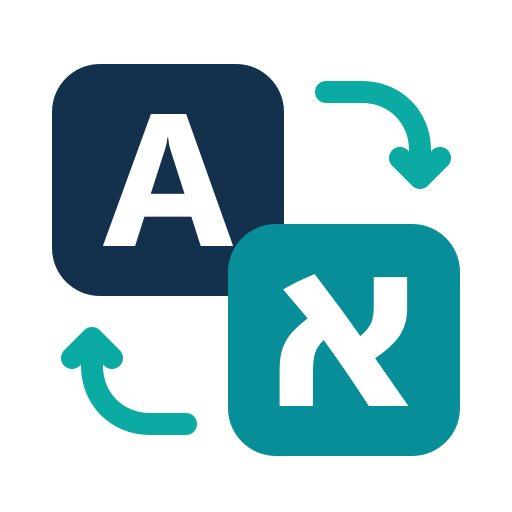

<h1 align="center">
<br>
Keyboard Layout Fixer
</h1>

<p align="center"><a href="#français">Français</a> · <a href="#עברית">עברית</a></p>

<p align="center"><b>Typed <code>akuo</code> instead of <code>שלום</code>? Press F10.</b><br>
A small, free Windows app that fixes text typed with the wrong keyboard layout (Hebrew ⇄ English, or Hebrew ⇄ French AZERTY) and text typed with Caps Lock on.</p>

<p align="center">
<a href="https://github.com/breslev558/hebrew-keyboard-layout-fixer/releases/latest/download/KeyboardLayoutFixer-Setup.exe">
<picture>
<source media="(prefers-color-scheme: dark)" srcset="docs/download-dark.svg">
<source media="(prefers-color-scheme: light)" srcset="docs/download-light.svg">

</picture>
</a>
</p>

<p align="center"><sub>
KeyboardLayoutFixer-Setup.exe, about 0.5 MB, for Windows 10 and 11 (x64)<br>
<a href="https://github.com/breslev558/hebrew-keyboard-layout-fixer/releases/latest/download/KeyboardLayoutFixer-Setup-arm64.exe">ARM64 installer</a> (Snapdragon, Copilot+ PCs) ·
<a href="https://github.com/breslev558/hebrew-keyboard-layout-fixer/releases/latest/download/KeyboardLayoutFixer.zip">zip</a> ·
<a href="https://github.com/breslev558/hebrew-keyboard-layout-fixer/releases/latest">all release files</a> ·
<a href="https://breslev558.github.io/hebrew-keyboard-layout-fixer/">website</a>
</sub></p>

<p align="center">
<a href="https://github.com/breslev558/hebrew-keyboard-layout-fixer/releases/latest"></a>
<a href="https://github.com/breslev558/hebrew-keyboard-layout-fixer/actions/workflows/ci.yml"></a>
<a href="https://www.bestpractices.dev/projects/16504"></a>
<a href="https://scorecard.dev/viewer/?uri=github.com/breslev558/hebrew-keyboard-layout-fixer"></a>
</p>

<p align="center"></p>

## How it works

You meant to type `שלום`, but the keyboard was still on English, so you got `akuo`.
Select the text (or just leave the cursor at the end of it) and press **F10**: it becomes `שלום`, and the keyboard switches to Hebrew so you can keep typing. It works the other way too: `גםןמע` → `hello`.

- **F10** converts the selected text to the other layout. With nothing selected, it converts from the cursor back to the start of the line (the whole paragraph in chat boxes and browsers).
- **F10 again** within 5 seconds, in the same field and with nothing typed in between, puts the original text back; a third press converts it again.
- **F9** fixes text typed with Caps Lock on (`hELLO wORLD` → `Hello World`) and turns Caps Lock off.
- A small bubble shows what changed (`akuo → שלום`). It can be switched off in the tray menu.
- F10 works by copy and paste: your clipboard is saved first and put back afterwards. Password fields, administrator windows and consoles are left alone.
- It lives in the tray (the icon near the clock). Once installed, it is a single executable under 1 MB, written in Rust, with nothing else to install (no .NET). Native builds for x64 and ARM64.

## Install

1. [Download **KeyboardLayoutFixer-Setup.exe**](https://github.com/breslev558/hebrew-keyboard-layout-fixer/releases/latest/download/KeyboardLayoutFixer-Setup.exe) and double-click it. On a Windows on ARM PC (Snapdragon, Copilot+), use [KeyboardLayoutFixer-Setup-arm64.exe](https://github.com/breslev558/hebrew-keyboard-layout-fixer/releases/latest/download/KeyboardLayoutFixer-Setup-arm64.exe).
2. If Windows shows **“Windows protected your PC”**, click **More info**, then **Run anyway**. (The program is not yet signed with a recognised certificate; a free [SignPath](https://signpath.org) signature has been requested.)
3. That's all. No administrator rights are needed: the program is installed for your account only, starts with Windows, and shows a short welcome window with a **Try it now** box.

To update by hand, run a newer installer over the old one: the running copy is closed cleanly and your settings are kept.

<details>
<summary><b>Check the download, or install without the installer</b></summary>

- **SHA-256**: in PowerShell, run `Get-FileHash KeyboardLayoutFixer-Setup.exe` and compare the result with the `.sha256` file on the [release page](https://github.com/breslev558/hebrew-keyboard-layout-fixer/releases/latest).
- **Build provenance**: the x64 files are built by GitHub Actions from this repository, with a provenance attestation. With the GitHub CLI: `gh attestation verify KeyboardLayoutFixer-Setup.exe --repo breslev558/hebrew-keyboard-layout-fixer`.
- **Without the installer**: download the [zip](https://github.com/breslev558/hebrew-keyboard-layout-fixer/releases/latest/download/KeyboardLayoutFixer.zip) (x64), extract it and double-click **Installer.cmd**.
- **Where it goes**: the program in `%LOCALAPPDATA%\Programs\KeyboardLayoutFixer`, your settings in `%APPDATA%\KeyboardLayoutFixer`.

</details>

## Everyday use

- **Click the icon** to open the settings, in English, Hebrew or French: the keys (F10 and F9 can be changed), the conversion direction, careful mode (selected text only), Caps Lock behaviour, where the bubble appears (top, bottom or near the cursor), rules per program, diagnostics, and export or import of your settings.
- **Right-click the icon** for the menu: pause (10 minutes or until you resume), disable in the current program, the options below, updates, problem reports, about, exit.

## Optional features

All are off by default and are switched on from the tray menu. They are not available when settings are enforced by an administrator (see [For administrators](#for-administrators)).

- **Suggest fixes while typing (Tab)**: when the last words you typed are real words on the *other* layout, a small bubble offers the fix. **Tab** fixes them and switches the keyboard; any other key dismisses it. It learns from you (tray menu › **My words…**).
- **F10 fixes only the wrong words**: you started in the right language and went on in the wrong one? One F10 fixes only the words typed on the wrong layout. It uses the word lists; if no word looks wrong, everything is converted as usual.
- **Chat apps: hold back a sentence in the wrong language**: in WhatsApp, Telegram, Teams, Signal, Discord, Slack and similar apps, the first Enter is held back with a warning when the whole sentence is in the wrong language. Press Enter again to send it anyway. The program never presses Enter itself.
- **Left Ctrl = English, right Ctrl = Hebrew**: a short tap on Ctrl alone switches the keyboard. Any other key or a click cancels it.
- **One-language programs (e.g. Terminal in English)**: Windows Terminal, PowerShell, cmd and the Run box (Win+R) switch to English when they come to the front. Edit the list in **List of programs…**: one `program.exe` per line, or `program.exe = he` for Hebrew.
- **Double-tap Shift to convert (like F10)**: handy on laptops where F10 needs the Fn key. Never with Ctrl, Alt or Win held, in full-screen games, or in JetBrains IDEs (where double Shift opens their search).
- **Text replacements (e.g. @@ → email address)**: your own shortcuts in **My replacements…** (`%APPDATA%\KeyboardLayoutFixer\replacements.txt`), one `shortcut = text` per line, for example `@@ = name@example.com`. Type the shortcut, then Space, and it is replaced; **Backspace** right after undoes it. The list is empty until you write it.
- **Short sound when a word is fixed**: a soft sound of the program's own.

<details>
<summary><b>More about fixing while typing</b></summary>

- **How it decides**: a word is offered only when its keys spell a known word on the other layout and not on the current one. Names, brands, typos and words in CAPITALS are left alone. Rare words and Hebrew words with prefixes (וכשהלכתי) are recognised by letter models built on your PC from the same word lists. Short words such as `kt` (לא) are fixed together with the wrong word after them. The keys `, . ; / '` count as letters inside a word (`ac,` = שבת).
- **Learning**: a word you fix with F10 is noted the first time and learned the second time, on another day; a note not confirmed within 30 days is forgotten. **Backspace** right after a fix undoes it, and that word is never fixed again. Both lists are in **My words…** (a plain text file on your PC that you can edit).
- **Where it never acts**: password fields (including those of web pages and Electron apps), consoles, administrator windows, full-screen games and presentations, code editors (VS Code, Visual Studio, JetBrains…, by default), password managers, crypto wallets, remote desktop windows, and programs you disabled it in. The tray icon turns grey while it sleeps, and its tooltip says why.
- **What it reads**: while this option is on (or **Text replacements**, **Double-tap Shift**, **Left Ctrl = English, right Ctrl = Hebrew** or **Chat apps: hold back…**), the program watches the keys typed through a low-level keyboard hook. It keeps only the last few words, in memory, and forgets them on a click, arrow keys, Enter, a shortcut, another window, sleep, lock or a pause. What you type is never sent and never written to disk (only the words you teach it go to **My words…**).
- **Word lists**: the Hebrew and English lists (40,000 words each, see [THIRD_PARTY_NOTICES.md](THIRD_PARTY_NOTICES.md)) are downloaded once from this repository when you switch the option on. They are signed and checked before use.
- **Wrong or missing fix?** Use the [wrong fix form](https://github.com/breslev558/hebrew-keyboard-layout-fixer/issues/new?template=wrong-fix.yml). Real cases are added to `tests/typing-cases.tsv` and checked by the tests.

</details>

## Updates

Once a day the program asks GitHub whether a newer version exists. No identifier is sent; GitHub sees your IP address, as with any download. If there is a new version, a bubble tells you and the tray menu offers **Install version X**. Nothing is installed without your click. The ARM64 version updates itself with its own ARM64 files.

Before switching, the program checks the new file's SHA-256 and a digital signature (ECDSA P-256) made with a key kept offline, using Windows cryptography. If anything fails, or the new version does not start within 60 seconds, the previous version is put back automatically. To turn the check off, untick **Check for updates** in the tray menu.

## Uninstall

**Windows Settings › Apps › Installed apps** (on Windows 10: **Apps & features**) › **Keyboard Layout Fixer** › **Uninstall**. The program, its startup entry and its shortcut are removed. The uninstaller asks whether to also delete your settings and the words the program learned (default: no).

## Privacy

- What you type is never sent anywhere. Nothing is written to disk except the words you teach it (**My words…**) and your own replacements, which stay on your PC. No account, no ads, no telemetry.
- The network is used in three optional cases only: the **daily update check** (GitHub), the **word lists** for fixing while typing (downloaded once), and **anonymous problem reports**, sent only if you click.
- All network use is turned off when settings are enforced by an administrator (see [For administrators](#for-administrators)).

Details: [PRIVACY.md](PRIVACY.md) and [THREAT_MODEL.md](THREAT_MODEL.md).

<details>
<summary><b>What a problem report contains</b></summary>

After a real error, a Windows notification asks *“Send an anonymous report to help fix it?”*. Nothing is sent unless you click it. A report contains only: report type, program version, Windows build, result, action (F10 or F9), the step that failed and step timings, the program name and window classes (for example `winword.exe`, `OpusApp`), the kind of selection, the number of characters, and the comment you may write in **Report a problem…** (you see the exact content before sending).

Never your text or clipboard, no file path, no identifier. The receiver (a small Cloudflare Worker) does not store IP addresses and deletes reports after 90 days. Tray menu › **Problem reports**: report a problem, send reports without asking (off by default), or never offer a report.

The diagnostics (Settings › **Diagnostics**) show program names, window classes, text sizes, settings and steps, never your text. They stay on your PC unless you copy them.

</details>

## Security

- Report a security problem **privately**: see [SECURITY.md](SECURITY.md).
- Every change is checked on GitHub: tests on Windows (including a real F10 in Notepad), CodeQL, cargo-audit and cargo-deny, strict Clippy and fuzzing. OpenSSF Scorecard runs every week.
- Updates and word lists are signed, and the program checks them before use.
- What the program can see and keep, and how each risk is handled: [THREAT_MODEL.md](THREAT_MODEL.md).

## Limitations

- F10 recognises password fields in advance only in standard Windows controls. Elsewhere, protection relies on the program blocking copy. (Fixing while typing also recognises the password fields of web pages and Electron apps.)
- Text in programs running as administrator cannot be converted: Windows blocks the simulated keys.
- Most clipboard contents (text, pictures, files) are put back. Some embedded Office objects (OLE) may come back as text or a picture.
- If the clipboard cannot be put back at once (another program keeps it busy), it is kept **in memory only** for 10 minutes: use **Put back the previous clipboard** in the tray menu.
- F10 converts key positions: it does not guess the intended language, and punctuation alone is not always reversible.
- Only Hebrew with English or French AZERTY is supported. Other layouts (Russian, Arabic…) are refused rather than guessed.

## FAQ

<details>
<summary><b>Windows or my antivirus warns about the program</b></summary>

Until the program is signed with a recognised certificate, SmartScreen shows *Windows protected your PC*, and a few antivirus programs based on machine learning may flag the unsigned installer. Check the SHA-256 against the release page, or build it yourself from source. The program also uses a low-level keyboard hook (see [Does it watch my keyboard?](#keyboard-hook)), which some antivirus programs dislike.

</details>

<a name="keyboard-hook"></a>
<details>
<summary><b>Does it watch my keyboard?</b></summary>

With only F10 and F9, a minimal hook **counts** key presses (a number, never which key) so that Caps Lock can be turned off safely and a quick second F10 can put the text back. The options that read the keys (**Suggest fixes while typing**, **Text replacements**, **Double-tap Shift**, **Left Ctrl = English, right Ctrl = Hebrew**, **Chat apps: hold back…**) do so only while they are on, keep the last few words in memory only, and never send them. See [THREAT_MODEL.md](THREAT_MODEL.md).

</details>

<details>
<summary><b>F10 converted the wrong thing</b></summary>

Press F10 again at once to put the original text back, or Ctrl+Z in the program. Then select exactly the text to fix and press F10. To convert only selected text, turn on **Careful mode** in the settings.

</details>

<details>
<summary><b>F10 does nothing in one program</b></summary>

Some programs (administrator windows, games, some remote desktops) do not accept simulated keys. Check in the tray menu whether the fixer is paused or disabled in that program, and see Settings › **Diagnostics** for what happened.

</details>

<details>
<summary><b>I play online games with anti-cheat</b></summary>

Anti-cheat systems may dislike programs that use keyboard hooks. Before playing, quit the fixer (tray menu › **Exit**, not just pause) and start it again afterwards.

</details>

<details>
<summary><b>Can I use a key other than F10?</b></summary>

Yes: Settings › **Simple** › **Language key** (and **Case key (Caps Lock)** for F9). You can also turn on **Double-tap Shift to convert (like F10)** in the tray menu.

</details>

<details>
<summary><b>Which keyboards does it support?</b></summary>

Hebrew (including Hebrew Standard 2018) with any Latin layout: US, UK, French AZERTY; German or Swiss QWERTZ and Belgian AZERTY use a table read from Windows. With three layouts or more, Hebrew is converted to the Latin layout you used last.

</details>

## For administrators and developers

### For administrators

Settings can be enforced for every account under `HKLM\SOFTWARE\Policies\KeyboardLayoutFixer`, which standard users cannot change. The names are the same as in `settings.json`:

- `REG_DWORD` 0/1: `RequireSelection`, `TurnOffCapsLock`, `ConsoleSupport`, `LastWordOnly`, `Indicator`, `ShowBubble`, `ShowPreview`, `PlaySound`, `SwitchLanguageAfterConvert`, `CheckUpdates`.
- `REG_DWORD` values: `MaxCharacterLimit`, `PasteDelayMs` (100–10000), `MixedTextMode` (0–2), `BubblePosition` (0 top, 1 bottom, 2 cursor), `HotkeyModifiers` and `HotkeyKey`, `CaseHotkeyModifiers` and `CaseHotkeyKey`.
- `REG_SZ`: `UiLanguage` (`auto`, `he`, `fr`, `en`).
- Subkeys: `AppRules` (one value per program: `Disabled` or `SelectionOnly`) and `ExcludedProcesses`.

Enforced settings are greyed out in the settings window and never written to the user's file. When this key exists, updates, problem reports and the optional features are not available.

### Build from source

<details>
<summary><b>Requirements and commands</b></summary>

Requirements: Rust (the version is pinned in `rust-toolchain.toml`), the MinGW-w64 linker (`x86_64-w64-mingw32-gcc`), Bash and Python 3.

```
rustup target add x86_64-pc-windows-gnu
bash tools/construire.sh
```

The script runs the tests, checks the dependency licences and builds `target/x86_64-pc-windows-gnu/release/KeyboardLayoutFixer.exe` with a `BUILD-INFO.txt`. The installer is built with NSIS:

```
makensis -DVERSION=x.y.z -DEXE=<path to the exe> -DICON=crates/klf-win/res/klf.ico installer/KeyboardLayoutFixer.nsi
```

Releases are built by [`.github/workflows/release.yml`](.github/workflows/release.yml). Manual checks on Windows are listed in [TESTS.md](TESTS.md).

</details>

**Project files**: [CHANGELOG.md](CHANGELOG.md) · [PRIVACY.md](PRIVACY.md) · [THREAT_MODEL.md](THREAT_MODEL.md) · [SECURITY.md](SECURITY.md) · [PERFORMANCE.md](PERFORMANCE.md) · [CONTRIBUTING.md](CONTRIBUTING.md) · [CODE_SIGNING_POLICY.md](CODE_SIGNING_POLICY.md) · [audits/](audits)

## Français

**Vous avez tapé `akuo` au lieu de `שלום` ?** Sélectionnez le texte et appuyez sur **F10**. Sans sélection, le texte est corrigé du curseur jusqu'au début de la ligne. Un second appui dans les 5 secondes remet le texte d'origine. **F9** corrige un texte tapé avec Verr. Maj activé. Hébreu ⇄ anglais, ou hébreu ⇄ français AZERTY. Gratuit, pour Windows 10 et 11.

- **Installation** (sans droits d'administrateur) : [téléchargez **KeyboardLayoutFixer-Setup.exe**](https://github.com/breslev558/hebrew-keyboard-layout-fixer/releases/latest/download/KeyboardLayoutFixer-Setup.exe) (PC Windows sur ARM : [version ARM64](https://github.com/breslev558/hebrew-keyboard-layout-fixer/releases/latest/download/KeyboardLayoutFixer-Setup-arm64.exe)) et double-cliquez dessus. Si Windows affiche « Windows a protégé votre ordinateur » (le programme n'est pas encore signé avec un certificat reconnu) : **Informations complémentaires**, puis **Exécuter quand même**.
- **Paramètres** : cliquez sur l'icône près de l'horloge. Clic droit pour le menu : pause, désactivation dans un programme, options.
- **Options** (désactivées par défaut, dans le menu de l'icône) :
  - **Proposer la correction pendant la frappe (Tab)** : une bulle propose la correction, Tab l'accepte. Le programme apprend de vos corrections (**Mes mots…**). Jamais dans un champ de mot de passe, y compris sur les pages web.
  - **F10 ne corrige que les mots faux** : seuls les mots tapés avec le mauvais clavier sont corrigés.
  - **Messageries : retenir l'envoi d'une phrase dans la mauvaise langue** : un second appui sur Entrée l'envoie quand même.
  - **Ctrl gauche = anglais, Ctrl droit = hébreu**, **Programmes à une seule langue (ex. le Terminal en anglais)**, **Double appui sur Maj = conversion (comme F10)**.
  - **Remplacements de texte (ex. @@ → adresse mail)** : vos propres abréviations dans **Mes remplacements…**, une par ligne, par exemple `@@ = nom@exemple.com` ; tapez l'abréviation puis Espace.
- **Mises à jour** : une fois par jour, une bulle signale une nouvelle version. Elle ne s'installe qu'après votre clic dans le menu, et après vérification de sa signature. Vous pouvez les désactiver dans ce menu (**Rechercher des mises à jour**).
- **Désinstallation** : Paramètres › Applications › Applications installées (Windows 10 : Applications et fonctionnalités) › Keyboard Layout Fixer. Le désinstalleur propose d'effacer aussi vos réglages et les mots appris (non par défaut).
- **Jeux avec anti-triche** : quittez le programme avant de jouer (menu de l'icône › **Quitter**).
- **Vie privée** : rien de ce que vous tapez n'est envoyé ; seuls les mots appris et vos remplacements sont enregistrés, sur votre PC. Après une vraie erreur, une notification propose d'envoyer un rapport anonyme (version, étape en échec, nom du programme, jamais votre texte) : rien ne part sans votre clic.

## עברית

**הקלדתם `akuo` במקום `שלום`?** סמנו את הטקסט ולחצו **F10**. בלי סימון, הטקסט מתוקן מהסמן ועד תחילת השורה. לחיצה נוספת תוך 5 שניות מחזירה את הטקסט המקורי. **F9** מתקן טקסט שהוקלד כש-Caps Lock היה מופעל. עברית ⇄ אנגלית, או עברית ⇄ צרפתית AZERTY. חינם, למערכות Windows 10 ו-Windows 11.

- **התקנה** (בלי הרשאות מנהל): [הורידו את **KeyboardLayoutFixer-Setup.exe**](https://github.com/breslev558/hebrew-keyboard-layout-fixer/releases/latest/download/KeyboardLayoutFixer-Setup.exe) ולחצו עליו פעמיים. אם מופיעה ההודעה "Windows הגן על המחשב שלך" (התוכנה עדיין לא חתומה בתעודה מוכרת), לחצו **מידע נוסף** ואז **הפעל בכל זאת**.
- **הגדרות**: לחיצה על הסמל ליד השעון. לחיצה ימנית פותחת את התפריט: השהיה, כיבוי בתוכנה מסוימת, אפשרויות.
- **אפשרויות** (כבויות כברירת מחדל, בתפריט הסמל):
  - **הצע תיקון בזמן ההקלדה (Tab)**: בועה קטנה מציעה את התיקון, ומקש Tab מאשר אותו. התוכנה לומדת מהתיקונים שלכם (**המילים שלי…**). לעולם לא בשדות סיסמה, גם לא בדפי אינטרנט.
  - האפשרות **F10 מתקן רק את המילים השגויות**: רק המילים שהוקלדו בשפה הלא נכונה מתוקנות.
  - **בתוכנות צ'אט: עצירה לפני שליחת משפט בשפה הלא נכונה**: לחיצה נוספת על Enter שולחת בכל זאת.
  - האפשרות **Ctrl שמאלי = אנגלית, Ctrl ימני = עברית**: לחיצה קצרה על Ctrl השמאלי מעבירה לאנגלית, ועל Ctrl הימני לעברית.
  - **תוכנות בשפה אחת (למשל הטרמינל באנגלית)**, **לחיצה כפולה על Shift ממירה (כמו F10)**.
  - **החלפות טקסט**: הקיצורים שלכם ב-**ההחלפות שלי…**, שורה לכל קיצור, למשל <span dir="ltr">`@@ = name@example.com`</span>; מקלידים את הקיצור ואז רווח.
- **עדכונים**: פעם ביום מופיעה הודעה כשיש גרסה חדשה. היא מותקנת רק אחרי לחיצה שלכם בתפריט הסמל, ואחרי בדיקת החתימה. אפשר לכבות את הבדיקה באותו תפריט (**בדוק אם קיימים עדכונים**).
- **הסרה**: הגדרות › אפליקציות › אפליקציות מותקנות › Keyboard Layout Fixer. תוכנית ההסרה שואלת אם למחוק גם את ההגדרות ואת המילים שהתוכנה למדה (ברירת המחדל: לא).
- **משחקים עם אנטי-צ'יט**: לפני המשחק צאו מהתוכנה (תפריט הסמל › **יציאה**).
- **פרטיות**: שום דבר ממה שאתם מקלידים לא נשלח. רק המילים שהתוכנה למדה וההחלפות שלכם נשמרים, במחשב שלכם. אחרי תקלה אמיתית מוצע לשלוח דיווח אנונימי (גרסה, השלב שנכשל, שם התוכנה, לעולם לא הטקסט שלכם), ושום דבר לא נשלח בלי לחיצה שלכם.

## Credits and licence

Based on [Keyboard Layout Fixer](https://github.com/RavidSaadia/Keyboard_Layout_Fixer) by Ravid Saadia (MIT licence). His original .NET documentation, which does not apply to this version, is archived in [docs/archive](docs/archive). This version, rewritten in Rust with new features, is by breslev558 and is also under the MIT licence: see [LICENSE](LICENSE).
